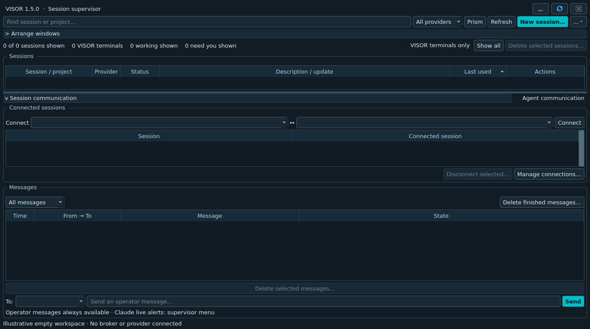

# VISOR — AI CLI session supervisor

VISOR is a compact desktop supervisor for Codex and Claude Code. Agent sessions run in separate terminal windows with their own movement, sizing and application switching. The supervisor provides discovery, exact-session launch/resume, Focus, arrangement, operator messages, approved agent pairs, and graceful wrap-up tracking.

**Beta 0.1.0b1 — evaluation release candidate.** Windows and Linux/X11 have recorded build and selected live checks. **macOS is experimental: no live Mac build or desktop testing has been completed.** Changing the release label to beta does not certify every platform or feature. See [platform evidence](docs/STATUS.md), [known limits](docs/ROADMAP.md), and [beta release notes](docs/RELEASE_NOTES.md).

Source is MIT licensed. Provider accounts, provider software and their normal permissions remain yours to manage. VISOR does not bypass provider approvals.

## What you can do

- Find saved Codex and Claude Code sessions, then resume the exact conversation in its project.
- Bring a verified terminal forward and arrange selected managed windows.
- Send operator messages and distinguish delivery, acknowledgment and completion.
- Allow selected pairs of sessions to exchange messages; communication is explicit and non-transitive.
- Ask agents to wrap up, save context and report unfinished work while their terminals remain available for inspection.

## Platform status

| Platform | Requirements | Verified evidence and limits |
| --- | --- | --- |
| Windows | Windows Terminal (`wt.exe`); native provider executable on PATH | Earlier native build/package and live Codex delivery checks; operator-confirmed Focus. This beta still needs its own Windows build and clean-machine checks. Unsigned. |
| Linux/X11 | `xterm`, `wmctrl`, Qt runtime libraries | Ubuntu/KWin native packaging and disposable-window checks recorded. Full provider, reboot, accessibility and multi-monitor acceptance remain open. |
| macOS | macOS 14+ for the locked Qt wheels; Terminal.app; native Python 3.12 for source builds | Experimental implementation and CI workflow only. No live Mac testing or native build result. Automation permissions, Finder launch and window controls remain unverified. |
| Linux/Wayland | XWayland for xterm | Programmatic Focus, arrangement and managed-window closure are unavailable. |

Windows and Linux beta downloads can be released independently after their checks and release approval. There is no verified macOS download yet. [macOS preparation and test plan](docs/MACOS.md).

## Run from source

Install Python 3.12 and [uv](https://docs.astral.sh/uv/getting-started/installation/), then clone or download this source and open a terminal in the project directory. Install Codex and/or Claude Code separately and sign in through the provider's normal login. One missing provider does not block the other. Codex integration was checked with `codex-cli 0.163.0`; compatibility with older versions is not promised.

Windows:

```powershell
py -3.12 scripts/bootstrap.py
.venv/Scripts/python.exe scripts/run.py --doctor
.venv/Scripts/python.exe scripts/run.py
```

Ubuntu/X11:

```sh
sudo apt-get install xterm wmctrl libegl1 libopengl0 libxcb-cursor0
python3.12 scripts/bootstrap.py
.venv/bin/python scripts/run.py --doctor
.venv/bin/python scripts/run.py
```

On macOS, use the Python commands above without the Ubuntu package-install command. Read [MACOS.md](docs/MACOS.md) before trying the experimental port.

Linux/macOS desktop launches load PATH from the interactive login shell so version managers such as NVM select the same provider executable as the terminal. Restart VISOR and its broker after changing shell configuration. Set `VISOR_SHELL_PATH=0` to keep the inherited PATH. `--doctor` reports the selected provider path/version; it does not authenticate or send a model request.

## Build and run a native package

Run `python3.12 scripts/native_build.py` on Linux/macOS or `py -3.12 scripts/native_build.py` on Windows. Native builds must run on their target OS. The command tests, builds and verifies an extracted package; it does not establish interactive desktop acceptance. See [development](docs/DEVELOPMENT.md) and [native acceptance](docs/NATIVE_ACCEPTANCE.md).

Windows packages contain `visor/visor.exe`; Linux packages contain `visor/visor`. Extract and keep the complete directory together. `visor-console` is the companion diagnostic/helper executable. macOS packaging is prepared to produce `visor.app` with an embedded helper, using an ad-hoc signature; Developer ID signing and notarization are pending. Build output and checksums live under `dist/`, with `dist/latest-build.json` identifying the current local build.

The GitHub workflow prepares Windows, Linux, Apple silicon and Intel Mac jobs. Remote CI has not run for this candidate. Manual workflow runs retain evaluation artifacts; they do not publish a GitHub Release.

Default state directories are `%LOCALAPPDATA%/Visor`, `~/Library/Application Support/Visor`, and `${XDG_DATA_HOME:-~/.local/share}/visor`. `--data-dir` isolates VISOR state, **not provider discovery or provider history**. Use disposable provider sessions when testing deletion. Data and messages remain local and unencrypted at rest; see [security](SECURITY.md).

## Use the supervisor

- **Refresh** reads Codex shared-server metadata and Claude history/live roster. Search, provider filtering and **Managed terminals only** restrict the visible rows. **Show all** clears all three filters; the count displays shown/total sessions.
- **New** selects a provider and project. **Resume** targets the saved session ID and project directory. Existing live ownership is checked to avoid duplicate workers. Registration by exact UUID is also available.
- **Focus** verifies terminal/helper identity, then activates from the supervisor UI. A unique directory alone is never used to identify a terminal. For an existing external terminal, use **Link external terminal for Focus…** in the session menu, choose a supported native window and confirm the link. The link focuses the window; check its selected tab. It does not establish provider/process ownership, so it cannot grant arrangement or deletion privileges. Unlink it before resuming or deleting that session.
- Drag edges/corners to resize the supervisor. Flexible tables, columns, splitter and composer fit the available space; minimum size, truncation and scrolling keep actions accessible. The middle title button restores the default size, minimize keeps work running, and X opens the exit choices.
- Session menus remain stable during periodic refresh. They provide Rename, Copy session ID, agent participation, Wrap up, **Delete session…**, and stale-window reconciliation.
- Arrangement acts only on selected, verified managed windows. Use Grid, Columns, Rows, Cascade, Save layout or Restore. Platform limitations are reported rather than guessed around.

**Delete session…** is permanent: after confirmation it immediately closes the verified linked terminal without Wrap up, deletes the provider conversation, then purges the session's VISOR messages, credentials, connections and layout entry. Running work can be lost; project source files remain. Refresh/restart cannot resurrect the deleted entry. Failure to verify/close a running terminal or delete provider history produces an error and preserves the VISOR record for retry. An externally launched live terminal must be closed first because its ownership is not yet associated.

Codex deletion uses documented `thread/delete`, including spawned descendant conversations; active and archived descendants are checked and their associated managed terminals closed first. Claude deletion removes the exact UUID's local main/subagent transcripts and session artifact directories under its configuration root, with path containment checks. It does not use project-wide `claude purge` or claim to erase provider cloud retention, shared logs or backups. Closure must be verified and known helper/observed descendant process identities must have stopped before history deletion. Process observations cannot account for every detached or scheduled job. Windows terminal closure and an isolated Codex deletion were tested previously; live macOS and provider-history deletion acceptance on Linux remain pending. macOS refuses deletion of windows containing additional tabs. Wayland window closure is unavailable through this adapter.

## Messaging and graceful wrap-up

Operator messages remain available independently of the agent communication toggle. Agent messages require an explicit direct pair, participation by both sessions, and the master agent communication toggle. One session can have several pairs; connections are not transitive. Credentials identify the sender and cannot call operator controls.

The queue distinguishes queued, held, sending, delivered, acknowledged, completed, failed and delivery-unknown states. Transport acceptance does not prove reading or completion. Disabling agent communication holds queued agent messages. Re-enabling does not automatically release held messages. Uncertain attempts are not blindly retried.

Agent traffic is also held after three identical messages in the same direction within five minutes,
or 24 messages across a pair within five minutes. The existing per-sender rate limit still applies.
Inspect the hold reason and explicitly release a message if appropriate; operator messages are exempt.

Wrap up requests a safe stopping point, context saving, validation/remaining-work report, and disclosure of owned background work. It holds agent delivery and tracks each requested session until explicit completion. Session menus configure the next request's wait time; progress reports elapsed time, transport state, exceeded waits and unresolved observed workers. A wait limit never kills work or releases held messages. Further wrap-up requests retain earlier tracked sessions. No reachable target produces an error, not an empty success. Completed agents leave their terminals open for inspection. Agent acknowledgment does not prove every background process stopped.

Closing offers Leave running, Request graceful shutdown, or Cancel. Leaving running preserves the broker and terminals. Reopening connects to the existing broker. Cancelling tracking cannot retract delivered requests or release held agent messages.

## Codex integration

Discovery attaches to the existing shared Codex server through `codex app-server proxy` using its WebSocket transport. Exact resume and message queue commands explicitly target `--remote unix://`. Thread IDs, provider-qualified VISOR IDs, helper PIDs and window identities remain separate.

Opening or creating a Codex session first runs the idempotent `codex app-server daemon start`
and verifies the control-socket handshake. Startup failures are shown before opening a terminal.
Discovery stays read-only; VISOR never restarts a running Codex daemon. A loaded session with
no active turn is shown as idle, independently of whether VISOR owns its terminal.

Messages are sent using Codex's queue interface. MCP acknowledgments work when the tools are attached. Already-loaded threads can lack the requested MCP configuration, so messages also provide an explicit reply receipt. The broker accepts only the exact receipt following its exact message envelope in the same recipient turn, with a final completed turn required for completion. It does not infer completion from ordinary prose. Receipt reconciliation runs separately from metadata refresh, checking up to four recipients per cycle in rotation. Each check reads recent turns and at most one older page, preserving its backfill cursor across broker restarts. It queries unresolved messages independently of the 200-message UI window. Repeated/expired cursors report errors; valid recent receipts survive a backfill error. Exhausted history is revisited after five minutes while recent turns keep being checked.

Full peer tools on already-loaded Codex threads still need attachment work. **Check peer tools** in a session menu inspects that thread's advertised inventory; it does not modify global configuration or prove end-to-end tool calls. Operator message/completion fallback is implemented and has passed live source and packaged tests. See the [Windows audit](docs/WINDOWS_ACCEPTANCE.md).

## Claude Code integration

The adapter follows the current [CLI reference](https://code.claude.com/docs/en/cli-reference), [agent-view JSON interface](https://code.claude.com/docs/en/agent-view), [hooks](https://code.claude.com/docs/en/hooks), and [channel protocol](https://code.claude.com/docs/en/channels-reference). Exact new/resume commands use `--session-id <UUID>` and `--resume <UUID>`, with a session-scoped `--mcp-config` and hooks supplied through `--settings`.

Discovery reads saved main-session transcripts under `CLAUDE_CONFIG_DIR/projects` or `~/.claude/projects`. The bounded, read-only metadata fallback tolerates incomplete records and does not infer live state from transcript prose. On Claude Code 2.1.290+, VISOR also uses the documented `claude agents --json --all` roster. Short background-job IDs are never mistaken for session UUIDs. Older versions are version-gated before any roster invocation, so an unknown command cannot accidentally become a prompt.

VISOR-managed sessions report working, waiting, idle, and disconnected events through scoped lifecycle hooks. Permission and input notifications report waiting. Stop events with background tasks or scheduled wakeups remain working. Hooks observe only: they never return an approval verdict, block a stop, or change global settings. Saved sessions without live evidence show unknown status.

Choose **Supervisor menu → Claude Code settings** before opening/resuming a Claude terminal:

| Mode | Behavior |
| --- | --- |
| Inbox only (default) | Normal MCP tools; Claude checks `receive` at safe boundaries. No unsolicited notifications. |
| Local preview channel | Uses the documented `--dangerously-load-development-channels server:visor` opt-in. Claude presents its own confirmation. Existing authentication, organization policy and tool approvals still apply. |
| Approved plugin | Uses `--channels plugin:visor@your-marketplace`. Requires the included VISOR plugin to be installed and allowed through Claude's distribution/policy process. |

The [plugin payload and setup notes](integrations/claude/README.md) are bundled. Local preview/inbox work from source or a package; approved plugin mode expects the packaged console helper. VISOR is not currently on Anthropic's public channel allowlist. Organization enablement and channel approval are external prerequisites, not permissions VISOR grants itself.

The channel advertises `claude/channel` and emits `notifications/claude/channel` with session-scoped message IDs, sender and kind. It declares no permission-relay capability. Because Claude may silently drop notifications blocked by policy, a successful write is recorded as delivery-unknown until an explicit acknowledgment arrives. MCP tools support receipt/completion, receiving and sending to approved peers. Operator wrap-up and Codex/Claude pairs use the same queue and policy. No second print-mode Claude worker is used to inject prompts into an existing interactive session.

Local protocol/subprocess tests cover discovery fixtures, version gating, launch flags, hooks, channel framing, sender/recipient isolation, cross-provider routing, wrap-up completion and reconnection after broker restart. **Live Claude model behavior has not been validated.** The integration is covered by simulated protocol/subprocess tests; those tests do not establish live provider compatibility.

## What remains

| Remaining code work | Current limit |
| --- | --- |
| Attach Codex peer tools to already-loaded threads | Operator receipts work; full MCP peer tools may be absent |
| External terminal ownership | Manual native-identity Focus links work; automatic provider/tab ownership association remains incomplete |
| Owned-work tracking | Helper descendants are observed and wait limits are configurable; detached/scheduled jobs and full stop verification remain incomplete |
| Further hardening | Crash/reboot/native-filesystem acceptance and native dependency redistribution review |

Offline storage maintenance is available after closing the broker: `visor-console --maintain-storage --retention-days 30 --compact`. It clears old completed/failed message text, keeps unresolved content and deduplication records, and compacts storage. This is opt-in and is not secure erasure.

Release work also remains: full native desktop/provider and monitor/DPI acceptance, clean-machine packaging, installers, exact distribution notices, signing/notarization, public repository publication. Live Claude model validation remains unclaimed. Public/organization channel approval is external to the code.

[STATUS.md](docs/STATUS.md) records evidence, [ROADMAP.md](docs/ROADMAP.md) tracks open work, and [MACOS.md](docs/MACOS.md) explains the experimental Mac port. See [DEVELOPMENT.md](docs/DEVELOPMENT.md), [ARCHITECTURE.md](docs/ARCHITECTURE.md), [CONTRIBUTING.md](CONTRIBUTING.md), and [SECURITY.md](SECURITY.md) for development and boundaries.

## Interface



This is the actual Linux offscreen UI with an empty session list, not a Mac screenshot or evidence of provider connectivity. No private projects or conversations are shown.

## Design and references

Related implementations reviewed: [wmux](https://github.com/amirlehmam/wmux) for owned terminals/single-instance activation, [Agent Session Hub](https://github.com/vinzify/Agent-Session-Hub) for discovery/resume, [Agent Deck](https://github.com/asheshgoplani/agent-deck) for broader session management, and [Windows Terminal foreground handoff](https://github.com/microsoft/terminal/blob/main/src/cascadia/WindowsTerminal/WindowEmperor.cpp). No implementation code from those projects was copied. Versioned Qt/PySide license and attribution files are preserved separately under `third_party`.

Other primary references: [Codex CLI](https://developers.openai.com/codex/cli/reference/), [Codex App Server](https://learn.chatgpt.com/docs/app-server), [Claude channels and availability](https://code.claude.com/docs/en/channels), [Qt for Python](https://doc.qt.io/qtforpython-6/), and [PyInstaller native builds](https://pyinstaller.org/en/stable/operating-mode.html).
